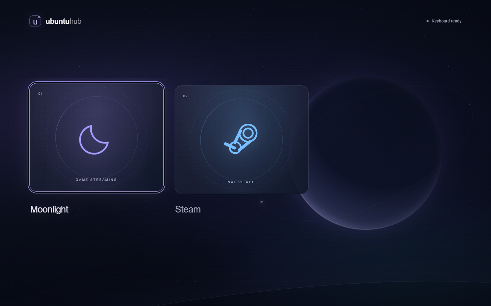

# UbuntuHub

A minimal, controller-first application launcher for Ubuntu. A full-screen Electron shell displays a horizontal library built with Next.js, TypeScript and Tailwind. Production uses a static export served by an internal Electron protocol; the launcher needs no HTTP server.

The interface includes slow aurora and starfield movement, a moon backdrop, and animated selection highlights. Motion pauses while the launcher is hidden and is disabled when the desktop requests reduced motion. All visuals are local CSS/SVG assets.

## Ubuntu setup

Use Ubuntu 22.04 or newer with a graphical desktop and Node.js 22 LTS (22.12 or newer). Run as your normal desktop user, not root.

```bash
sudo apt update
sudo apt install build-essential libnss3 libatk-bridge2.0-0 libdrm2 libgbm1 libxkbcommon0
# Ubuntu 24.04+:
sudo apt install libasound2t64
# Ubuntu 22.04 instead: sudo apt install libasound2
npm install
npm run dev
```

`npm run dev` compiles Electron, starts Next.js on 127.0.0.1:3000, waits for it, then opens the full-screen shell. Renderer changes hot reload. Restart the command after editing Electron sources or configuration. `npm run dev:ui` provides a browser preview; application launching requires Electron.

## Controls

| Action | Controller (standard mapping) | Keyboard |
| --- | --- | --- |
| Select | Left stick or D-pad left/right | Left/right arrows; Tab also focuses tiles |
| Launch | A / Cross | Enter / Space; click also launches |
| Return from a managed web window | B / Circle | Escape or Alt+F4 |
| Dismiss launcher message | B / Circle | Escape / Backspace |
| Return from Moonlight game library | B / Circle | Escape / Backspace |
| Quit launcher | — | Alt+F4 |

Navigation has a 0.55 stick dead zone, a 380 ms initial repeat delay, and a 145 ms repeat interval. Launch and return are edge-triggered. Reconnecting or regaining focus requires releasing A/B before pressing again. Selection stops at the ends of the library. The first connected standard-mapped controller controls the launcher; disconnecting it falls back to the next controller or keyboard. Some controllers require pressing a button before Chromium detects them.

## Configure applications

Edit `config/apps.json` during development. Packaged builds copy the bundled examples on first launch into Electron's user-data directory (normally `~/.config/UbuntuHub/apps.json`); edit that copy and restart. An explicit absolute configuration path overrides both:

```bash
UBUNTUHUB_CONFIG=/home/me/ubuntuhub/apps.json npm start
```

Moonlight and Steam are the configured tiles. Selecting Moonlight opens UbuntuHub's game library; Steam launches normally. The executable commands are `moonlight` and `steam`, assuming both are on your Ubuntu PATH. For a Flatpak Moonlight installation, set its `command` to `flatpak` and `args` to `["run", "com.moonlight_stream.Moonlight"]`. For an AppImage, set `command` to its absolute executable path and keep `args` empty. Restart UbuntuHub after editing the config. Already installed UbuntuHub builds use their saved user-data config, so update that copy too. See [Moonlight's official downloads](https://github.com/moonlight-stream/moonlight-qt#downloads) for installation options. Missing apps produce a recoverable error beneath the library.

To add a local Next.js project later, append an entry like this, changing the project directory to your own:

```json
{
  "id": "my-project",
  "name": "My project",
  "subtitle": "A local application",
  "icon": "web",
  "color": "#7ecfbb",
  "type": "web",
  "command": "npm",
  "args": ["run", "start", "--", "--hostname", "127.0.0.1", "--port", "3100"],
  "cwd": "~/Projects/my-next-app",
  "url": "http://127.0.0.1:3100",
  "startupTimeoutMs": 60000
}
```

- IDs must be unique lowercase letters, digits and hyphens. `name`, `type`, `command`, `args`, and `cwd` are required. `icon` accepts `terminal`, `files`, `web`, `moon`, or `steam`; `color` accepts a six-digit hex color.
- `cwd` expands `~`; relative paths resolve against the JSON file's folder. Commands are executables on PATH or absolute paths. Arguments are separate strings. Commands run without a shell; `&&`, pipes, environment assignments and shell expansion are not supported. Use a trusted executable script when needed. The config is trusted local code: its commands run with your user privileges.
- `native` starts a process in its own OS window. UbuntuHub minimizes once it starts and restores when it exits. Configure a foreground command that stays alive for the window's lifetime. GNOME Terminal uses `--wait` for this reason. Apps that delegate to an existing daemon (including Nautilus on some desktops) can exit their launcher process early; automatic return and duplicate detection then follow that process, not the daemon's window. Use a dedicated foreground instance when the app supports one.
- `web` starts a local server, waits for an HTTP success response, and opens a separate sandboxed Electron window. Only loopback HTTP URLs are accepted. Use a dedicated unused port; readiness checks cannot distinguish your server from another server already using that port. The timeout defaults to 60 seconds (configurable from 1 to 300 seconds). For `next start`, build the project first. Closing the web window stops its process group and restores UbuntuHub. B/Escape are reserved for return; controller return is reinstalled after full-page navigation.
- Native windows receive their own controller input; UbuntuHub cannot intercept B there. Close them using their own controls or Alt+F4. Desktop focus restrictions, especially on Wayland, can affect automatic focus; the launcher still shows/restores when the managed process exits.
- Duplicate launches of a tracked app are rejected. Startup errors and nonzero exits appear in the launcher. Linux process groups receive SIGTERM, followed by SIGKILL after two seconds, on managed web-window close or launcher shutdown. Descendants that detach into another process group are outside this tracking model.

## Moonlight game integration

1. Install a current Moonlight Qt version supporting `moonlight list --help` and `moonlight stream --help`. Set up Sunshine on the gaming PC and pair this Ubuntu device using Moonlight's own UI first. Add each game you want to launch under Sunshine's Applications; listing returns those published apps, not every game installed on the host.
2. Set `moonlight.host` in the Moonlight entry in `config/apps.json` to your PC's hostname, UUID or local IP address. The bundled value is intentionally empty. If UbuntuHub is already installed, add the `moonlight` object to its saved `~/.config/UbuntuHub/apps.json` instead.
3. Restart UbuntuHub and select Moonlight. With an empty `games` array, it runs `moonlight list` to discover available games. Left/right selects games or the library controls; A/Enter opens them. B/Escape returns to the main launcher. **Open Moonlight** launches its normal UI for pairing/settings; **Refresh games** fetches the host list again.

Example nested configuration (replace the example host and app names with your own):

```json
"moonlight": {
  "host": "192.168.1.100",
  "games": [
    { "id": "hades", "name": "Hades II", "app": "Hades II" },
    { "id": "steam-stream", "name": "Remote Steam", "app": "Steam Big Picture" }
  ],
  "streamArgs": ["--display-mode", "fullscreen", "--no-quit-after"]
}
```

`games` is optional. A nonempty list provides a curated library without fetching the host first; `app` must match the published Moonlight app name and defaults to `name`. Game IDs must be unique lowercase letters, digits or hyphens. Refresh replaces the in-memory library with the host's apps, retaining configured display names/IDs for matching games. Discovered games are cached for this launcher session; refresh errors preserve the previous list. They are not written back to the JSON file. Initial connection errors offer refresh/retry and access to the normal Moonlight UI. No host discovery, artwork download, pairing automation or Sunshine administration credentials are needed by UbuntuHub.

The Electron main process runs `moonlight stream` with the selected host/app as separate arguments and minimizes UbuntuHub. Closing/disconnecting Moonlight's CLI streaming session restores the same game library once its process exits. Moonlight owns all controller input while streaming: B is available to the game, not reserved by UbuntuHub. Use Moonlight's disconnect controls (normally Ctrl+Alt+Shift+Q on PC) to leave a stream. Exiting the remote game itself does not always end the stream. Default `--no-quit-after` leaves the host app running on disconnect; opt into `--quit-after` only if you want Moonlight to terminate the host app. See the [official CLI definitions](https://github.com/moonlight-stream/moonlight-qt/blob/master/app/cli/commandlineparser.cpp) and [Moonlight setup guide](https://github.com/moonlight-stream/moonlight-docs/wiki/Setup-Guide).

The command/args fields also support Flatpak and AppImage: command-prefix arguments precede `list` or `stream`. One managed Moonlight instance is allowed per configured Moonlight entry, so opening its normal UI and starting a stream share the duplicate lock. Refresh is blocked during a stream. Quit separately launched Moonlight instances before using UbuntuHub. CLI queries have a 35-second timeout and bounded output. The renderer can request only known game IDs; it cannot supply a host, executable or command arguments.

## Build and install

For ongoing updates, use **GitHub Releases and the AppImage**, described below. GitHub builds the Linux files for you; a local WSL build is optional. The `.deb` installer remains available for normal package installation and manual upgrades.

```bash
npm run typecheck
npm test
npm run build
npm start

# Build distributables on Ubuntu:
npm run dist:linux
sudo apt install ./release/ubuntuhub_0.1.0_amd64.deb
```

For just the Ubuntu installer (without also building AppImage), use `npm run dist:linux:deb`.

### Building on a Windows PC

Linux packaging runs inside Linux, including Ubuntu in WSL or a Linux Docker container. Running the packaging command directly in Windows PowerShell is rejected early with setup instructions. `EPERM ... symlink ... __appImage-x64` means packaging reached a Linux symlink operation on Windows; it is unrelated to the optional default-icon warning. UbuntuHub now includes its own Linux application icon.

If WSL has no Ubuntu distribution yet, run `wsl --install -d Ubuntu` in administrator PowerShell, restart if prompted, then open Ubuntu and finish creating its Linux user. Install Linux Node.js 22.12+ and npm in that Ubuntu environment. See [Microsoft's WSL installation guide](https://learn.microsoft.com/en-us/windows/wsl/install) and [Node.js downloads](https://nodejs.org/en/download).

Build a separate copy in WSL's Linux home folder, avoiding Windows-generated dependencies and output. Run these commands **in the Ubuntu terminal**:

```bash
sudo apt update
sudo apt install build-essential
mkdir -p ~/UbuntuHub
tar -C /mnt/d/Projekt/UbuntuHub \
  --exclude=node_modules --exclude=.next --exclude=out \
  --exclude=dist-electron --exclude=release \
  -cf - . | tar -C ~/UbuntuHub -xf -
cd ~/UbuntuHub
npm ci
npm run dist:linux:deb
explorer.exe .
```

Open `release` in the Explorer window and copy the generated `.deb` to your Ubuntu PC. Install it there using `sudo apt install ~/Downloads/ubuntuhub_*.deb` (adjust the folder to where you copied it). The destination PC needs Moonlight/Steam but does not need Node.js, npm or the project source. Use `npm run dist:linux` inside WSL instead if you also want an AppImage. Keep the build copy in `~/UbuntuHub`, rather than building on the Windows-mounted `/mnt/d` drive, and use Linux `node`/`npm` rather than Windows executables from PATH.

`npm run test:electron` runs a desktop integration smoke test after building. It opens the launcher with temporary Node-based fixtures, checks IPC, keyboard selection, native process return, launch failures, duplicate prevention, web-window return, and Moonlight library/stream lifecycle with simulated CLI and controller input. It writes `docs/launcher.png` and `docs/moonlight-library.png` and needs a graphical desktop. A real Sunshine/Moonlight session, physical controller mapping and Ubuntu window-manager focus still require testing on the target machine.



`npm run test:electron -- --capture` captures the configured launcher, checks background animation and reduced-motion support, and refreshes the screenshot above.

The `release/` directory also contains an AppImage. Mark it executable and run it from your desktop session. AppImage may require `libfuse2` (22.04) or `libfuse2t64` (24.04+); the `.deb` avoids the AppImage FUSE requirement. Keep Electron's sandbox enabled. This is a regular desktop launcher, not a replacement display manager or a Wayland compositor. Optional login startup can be configured through Ubuntu's Startup Applications using the installed `ubuntuhub` executable.

## GitHub Releases and in-app updates

### One-time repository setup

Create a **public GitHub repository** and push this project, including `.github/workflows`, `build`, and `package-lock.json`. No repository URL needs to be hardcoded: the release build derives the owner/name from GitHub's `GITHUB_REPOSITORY` environment variable and embeds the public release feed in the AppImage. `"private": true` in package.json only prevents npm publishing; it does not make the GitHub repository private. This workflow rejects private GitHub repositories, since the installed app is designed to download updates without credentials.

`ci.yml` builds and tests branch pushes and pull requests. `release.yml` runs for version tags, builds x64 Linux AppImage and DEB artifacts on Ubuntu, verifies metadata/checksums, and runs the Electron integration tests. A separate job publishes the GitHub Release only after those checks pass. GitHub supplies the publishing token automatically with `contents: write` in that job; no personal access token needs to be placed in the app or configured as a repository secret.

For the first release (the current version is 0.1.0), commit and push your code, then push its matching tag:

```bash
git tag v0.1.0
git push origin v0.1.0
```

Watch **Actions → Release** in GitHub. When it succeeds, **Releases** contains `UbuntuHub-x64.AppImage`, a `.deb`, `latest-linux.yml`, and any generated blockmap. Leave the update metadata and binaries together in the published release. Draft releases, prereleases and version downgrades are not used by this updater.

### First installation on the Ubuntu PC

Download `UbuntuHub-x64.AppImage` from your GitHub Release. Put it in a folder owned by your Linux user and keep that path stable:

```bash
mkdir -p ~/Applications
cp ~/Downloads/UbuntuHub-x64.AppImage ~/Applications/UbuntuHub-x64.AppImage
chmod +x ~/Applications/UbuntuHub-x64.AppImage
~/Applications/UbuntuHub-x64.AppImage
```

Use that AppImage path for any desktop shortcut or login-startup entry. The file and its containing directory must both be writable so the updater can replace it. Run it as your normal desktop user. A previously installed DEB can remain installed, but launch the AppImage rather than the DEB's application-menu entry to get in-app updates. Existing configuration remains in `~/.config/UbuntuHub/apps.json`; new bundled defaults do not overwrite it.

### Publishing an update

Commit your changes. In your Git checkout on Windows, increase the version and push the new commit/tag. For example, upgrading 0.1.0 to 0.1.1:

```bash
npm version patch
git push origin HEAD
git push origin v0.1.1
```

`npm version` updates both package.json and package-lock.json. The release workflow requires the tag to match the version exactly, so use the newly generated tag for subsequent releases. You do not need to build locally, transfer source files or reinstall on the Ubuntu PC.

The released AppImage checks for updates 15 seconds after startup and every six hours. Available updates download in the background, with progress shown in the footer. A **Restart to update** tile appears in the launcher and Moonlight library; select it with left/right and A/Enter, or click it. Installation is refused while any managed application is starting/running. Close those apps or disconnect Moonlight first, then select the action again. New launches are blocked during the update restart, and the replacement instance can take over the single-instance lock. Updates are never installed automatically on ordinary app exit.

Offline checks and download failures leave the launcher usable and offer **Retry update**. Installation errors keep the update available for retry. Settings stay separate from the executable. SHA512 verification of downloaded files is handled by electron-updater; the release workflow independently checks the generated artifact hash and embedded repository identity before publishing.

Automatic updates are disabled in development, non-Linux builds, DEB installs, AppImages without an embedded release feed, and read-only AppImage locations. Ordinary `dist:linux` builds have no feed; GitHub uses `dist:linux:release` with the repository/tag environment provided automatically. End-to-end download/replacement must be validated with two real GitHub releases on Ubuntu; local tests use a fake updater and never replace an executable or contact your GitHub account.

Development is possible on Windows/macOS, but example native commands and process-group management target Linux. Windows shell scripts such as `npm.cmd` are not directly executable with the shell-free launcher; validate local process launching on Ubuntu.

## Structure

```text
app/                          Next.js launcher and styling
app/moonlight-library.tsx      Controller-driven Moonlight games and controls
lib/controller.ts             Navigation repeat state machine
lib/use-controller.ts         Gamepad polling and keyboard input
shared/types.ts               Renderer-safe IPC contracts
electron/config.ts            JSON validation and path resolution
electron/moonlight.ts          Moonlight CLI discovery, game IDs and stream arguments
electron/update-manager.ts    Update state, download/retry and safe restart gating
electron/updater.ts           Released AppImage updater initialization
electron/process-manager.ts   Process lifecycle, readiness and cleanup
electron/main.ts              Windows, protocol, IPC and OS integration
electron/preload.ts           Narrow context-isolated bridge
config/apps.json              Editable application list (Moonlight and Steam)
tests/                        Configuration, repeat and process tests
.github/workflows/            CI checks and tag-triggered GitHub Releases
build/github-release.cjs      Automatic GitHub release feed configuration
```

Renderer Node integration is disabled. Both window types use context isolation and Chromium sandboxing. App windows have no preload or IPC access; the launcher bridge accepts app IDs, never renderer-supplied commands. IPC checks the sender window, main frame and URL. Popups, cross-origin navigation and permission requests are blocked. The production CSP permits inline scripts for Next.js hydration but disallows eval, frames and external network connections.

Implementation references: [Next.js static exports](https://nextjs.org/docs/app/guides/static-exports), [Electron security](https://www.electronjs.org/docs/latest/tutorial/security), and [context isolation](https://www.electronjs.org/docs/latest/tutorial/context-isolation).
